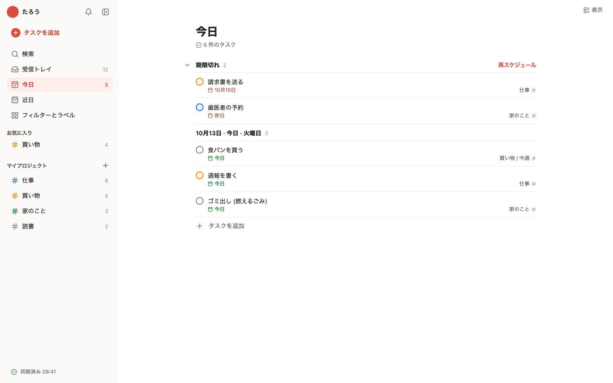
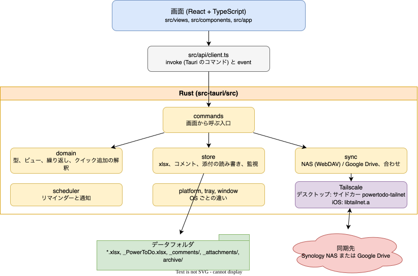

<div align="center">

# PowerToDo

**Excel のファイルで動く、Todoist 風の ToDo アプリ。**

[概要](docs/01-overview.md) | [クイックスタート](docs/02-quick-start.md) | [デスクトップ](docs/03-desktop.md) | [iPhone](docs/04-iphone.md) | [同期](docs/05-sync.md) | [内部資料](docs/internal/README.md)



</div>

## なぜ作るか

- **データは Excel のファイルである。** 1 つのプロジェクトが 1 つの xlsx になる。アプリが無くても Excel で開いて直せる。
- **Todoist と同じ操作で使う。** クイック追加、繰り返し、リマインダー、キーボードの操作、iPhone のスワイプを Todoist に合わせる。
- **自分の NAS で同期する。** Synology NAS (アプリの中の Tailscale 経由) か Google Drive に同期する。2 台で直しても、タスクごとに合わせる。

## できること

| | |
|---|---|
| 端末 | macOS、Windows、Linux のデスクトップと iPhone |
| タスク | プロジェクト、セクション、サブタスク、ラベル、優先度、期限と時刻、ボード表示 |
| 画面 | 受信トレイ、今日、近日、フィルターとラベル、検索 |
| クイック追加 | `牛乳 明日 p1 @食品` のように書くと、日付や優先度を読み取る |
| 繰り返しと通知 | `毎週水曜 10:00` のような言葉で繰り返す。OS の通知で知らせる |
| コメントと添付 | コメントを書き、画像やファイルを付ける |
| 同期 | Synology NAS か Google Drive |
| 更新 | 新しい版が出ると、アプリが入れ替える |

## 入れる

[Releases ページ](https://github.com/kousuke-takeuchi/PowerToDo/releases/latest) から、OS のファイルを取る。最初の起動の警告の越え方は [クイックスタート](docs/02-quick-start.md) にある。

開発するときは次のとおりである。Node.js、Rust、Go (版は `tailnet/go.mod`)、各 OS の Tauri 2 の前提ツールが要る。

```bash
npm install
npm run tauri dev
```

## ドキュメント

| # | 文書 | 内容 |
|---|---|---|
| 1 | [概要](docs/01-overview.md) | どんなアプリか。データの形と同期の全体像 |
| 2 | [クイックスタート](docs/02-quick-start.md) | 入れて、データフォルダを選び、最初のタスクを足すまで |
| 3 | [デスクトップ](docs/03-desktop.md) | 画面、クイック追加、繰り返し、リマインダー、添付、キー、Excel で直したとき |
| 4 | [iPhone](docs/04-iphone.md) | iPhone の画面と操作、データの場所 |
| 5 | [同期](docs/05-sync.md) | NAS と Google Drive の準備、2 台で直したとき、削除と archive |
| | [内部資料](docs/internal/README.md) | 開発する人のための資料 (構成、データ、リリース、iOS のビルド) |

## 仕組み



画面は React、中身は Rust で、Tauri 2 でアプリにする。くわしくは [docs/internal/architecture.md](docs/internal/architecture.md) にある。

## 開発に参加する

[CONTRIBUTING.md](CONTRIBUTING.md) を読む。設計仕様は `docs/superpowers/specs/`、実装計画は `docs/superpowers/plans/` にある。

## ライセンス

このリポジトリは非公開である。PowerToDo 自体のライセンスは決めていない。依存するものの一覧は [docs/internal/third-party-licenses.md](docs/internal/third-party-licenses.md) にある。

Todoist は Doist の製品である。PowerToDo は Todoist と関係が無い。
