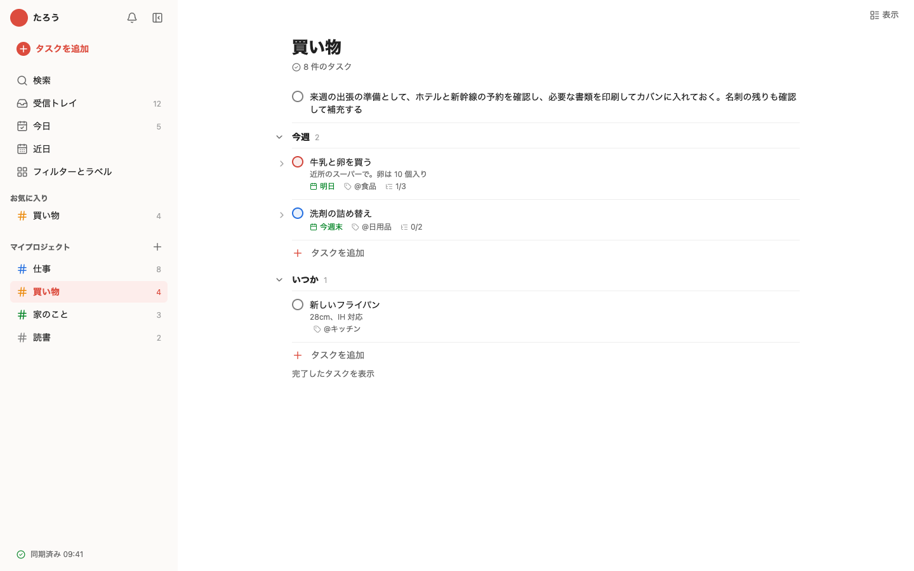
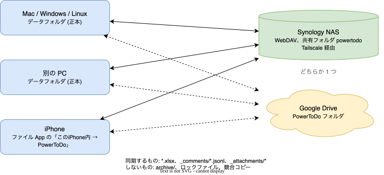

# PowerToDo の概要

Excel (xlsx) のファイルをそのままデータにした、Todoist 風の ToDo アプリである。デスクトップ (macOS、Windows、Linux) と iPhone で、同じデータを扱う。Android 版はまだ無い (後の作業)。



## データは xlsx のファイル

1 つのプロジェクトが、1 つの xlsx ファイルになる。アプリで直した内容は 1 秒後にファイルへ保存される。Excel や LibreOffice で開いて、直接直してもよい。

```text
<データフォルダ>/
  _PowerToDo.xlsx      共通ファイル (プロジェクトの一覧、ラベル、祝日、設定)
  受信トレイ.xlsx       受信トレイ
  仕事.xlsx            プロジェクト 1 つにつき 1 ファイル
  _comments/           コメントと添付の記録 (タスクごとに 1 ファイル)
  _attachments/        添付した画像とファイル
  archive/             削除したプロジェクトと、退避したファイル (消さずに移す)
```

xlsx の列の形は、[Qiita: エクセル七つ道具ではじめるシンプルなタスク管理](https://qiita.com/y-tetsu/items/c028737330fc47106fe8) に合わせ、列を足したものである。列の一覧は [内部資料のデータ](internal/data-model.md) にある。

## 端末の間で同期する

データフォルダを、Synology NAS か Google Drive のどちらか 1 つに同期する。NAS へは、アプリに入っている Tailscale でつなぐ。各端末に Tailscale のアプリは要らない。



くわしくは [同期](05-sync.md) にある。

## できること

| | |
|---|---|
| プロジェクトとタスク | セクション、サブタスク (多段)、ラベル、優先度、期限と時刻、並べ替え、ボード表示 |
| 今日と近日 | 期限が今日までのタスク、日ごとの予定。期限切れはまとめて今日へ移せる |
| クイック追加 | `牛乳 明日 p1 @食品` のように 1 行で書くと、日付や優先度を読み取る |
| 繰り返し | `毎週水曜 10:00` のような言葉で設定する。完了すると期限が次の回へ進む |
| リマインダー | OS の通知で知らせる。ウインドウを閉じてもトレイから届く |
| コメントと添付 | タスクにコメントを書き、画像やファイルを付ける |
| 検索 | ひらがなとカタカナ、全角と半角、大文字と小文字の違いを無視して探す |
| 同期 | NAS か Google Drive。2 台で同じプロジェクトを直しても、タスクごとに合わせる |
| 自動更新 | 新しい版が出ると、アプリが知らせて入れ替える |

## 次に読むもの

- 入れて始める: [クイックスタート](02-quick-start.md)
- デスクトップの使い方: [デスクトップ](03-desktop.md)
- iPhone の使い方: [iPhone](04-iphone.md)
- 同期の設定: [同期](05-sync.md)
