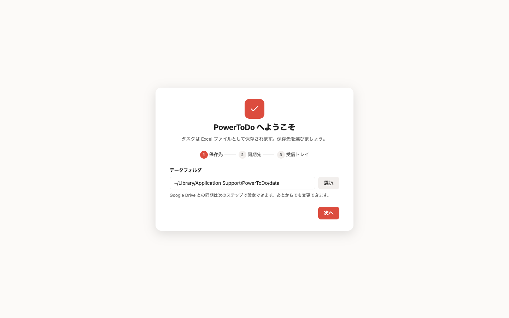
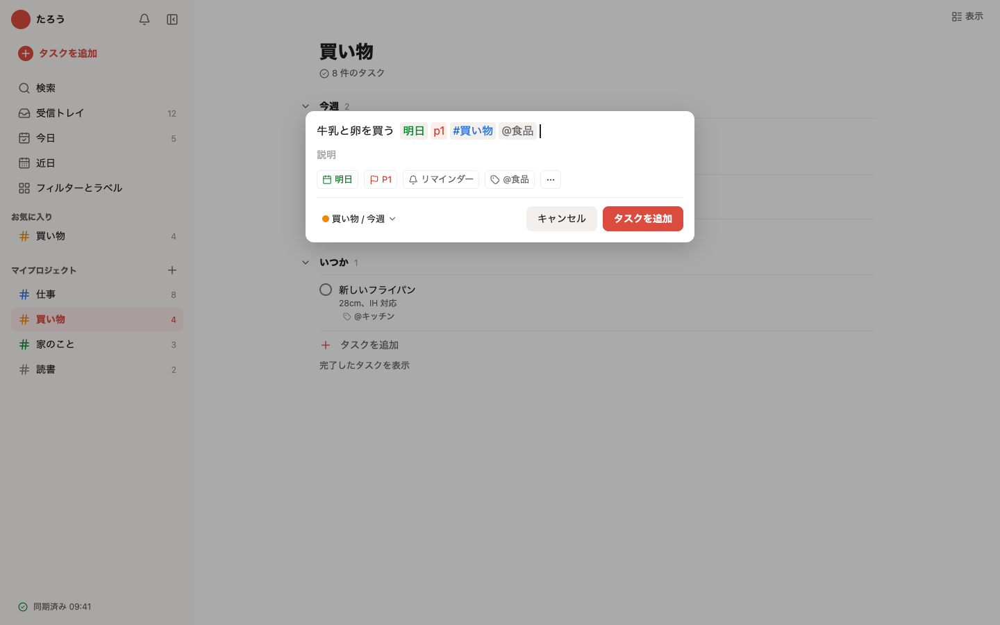

# クイックスタート

PowerToDo を入れて、最初のタスクを作るまでの手順である。

## 1. 入れる

[GitHub の Releases ページ](https://github.com/kousuke-takeuchi/PowerToDo/releases/latest) から、使っている OS のファイルを取る。

| OS | ファイル | 入れ方 |
|---|---|---|
| macOS (Apple シリコン) | `.dmg` (`aarch64`) | 開いて `PowerToDo` を `Applications` へドラッグする |
| macOS (Intel) | `.dmg` (`x64`) | 同上 |
| Windows | `-setup.exe` (または `.msi`) | 実行する。exe を勧める (ユーザー単位で入り、管理者権限が要らない)。msi は管理者向け |
| Linux | `.AppImage` | `chmod +x PowerToDo_*.AppImage` してから実行する |
| Linux (Debian / Ubuntu) | `.deb` | `sudo dpkg -i PowerToDo_*.deb` |
| Linux (Fedora など) | `.rpm` | `sudo rpm -i PowerToDo-*.rpm` |

iPhone 版は、所有者の iPhone に TestFlight か Xcode で入れる ([iOS のビルド](internal/ios-build.md))。

## 2. 最初の起動の警告を越える

このアプリはコード署名と公証をしていない。そのため OS の警告が出る。

| OS | 警告 | 越え方 |
|---|---|---|
| macOS | 「開発元を検証できないため開けません」 | `Applications` の `PowerToDo` を右クリック →「開く」→ もう一度「開く」。開けないときは、ターミナルで `xattr -d com.apple.quarantine /Applications/PowerToDo.app` を実行する。更新のあとに警告が出たら、同じ手順で開く |
| Windows | SmartScreen の「Windows によって PC が保護されました」 | 「詳細情報」→「実行」 |
| Linux | 出ない | AppImage は実行権限 (`chmod +x`) が要る |

## 3. データフォルダを選ぶ

初めて起動すると、データフォルダを選ぶ画面が出る。



1. 「選択」でデータフォルダを選ぶ。選ばずに「次へ」を押しても、フォルダを選ぶ画面が出る。
2. 「次へ」を押す。共通ファイル `_PowerToDo.xlsx` と `受信トレイ.xlsx` ができる (すでにあれば、そのまま使う)。
3. 同期先を選ぶ (Google Drive、Synology NAS、同期しない)。「スキップ」で同期しないまま進める。後から設定で変えられる ([同期](05-sync.md))。

設定の「データ」で、今のフォルダを見る、ファイラで開く、変えることができる。変えても、今のファイルは動かない。

## 4. タスクを足す

`q` を押すとクイック追加が開く。1 行で書いて `Enter` を押す。



```text
牛乳を買う 明日 p1 @食品
ゴミ出し 毎週火曜 8:00 #家のこと
```

日付、時刻、繰り返し、優先度 (`p1` から `p4`)、ラベル (`@`)、プロジェクト (`#`) を読み取り、残りをタスク名にする。書き方は [デスクトップ](03-desktop.md#クイック追加) にある。

## 5. 起動したときの画面を選ぶ

起動したときは「今日」の画面が開く。設定の「全般」の「起動時に開く画面」で「受信トレイ」に変えられる。この設定は端末ごとで、同期しない。

## 次に読むもの

- 画面と操作: [デスクトップ](03-desktop.md)
- 端末の間で使う: [同期](05-sync.md)
