# デスクトップ

デスクトップ版 (macOS、Windows、Linux) の画面と操作である。動作を確かめているのは macOS だけである。Windows と Linux は、CI でテストとビルドが通ることを確かめている。

## 画面

左の一覧から画面を選ぶ。

| 画面 | 中身 | |
|---|---|---|
| 受信トレイ | 行き先を決めていないタスク | |
| 今日 | 期限が今日までのタスク。期限切れは上にまとまり、「再スケジュール」で今日へ移せる | 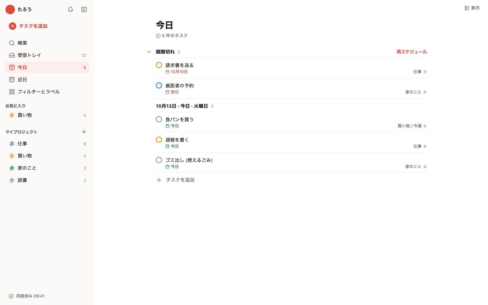 |
| 近日 | 今日から日ごとの予定。最初は 7 日分で、「さらに 7 日」で延ばせる (91 日まで)。週の帯と、月への移動 | 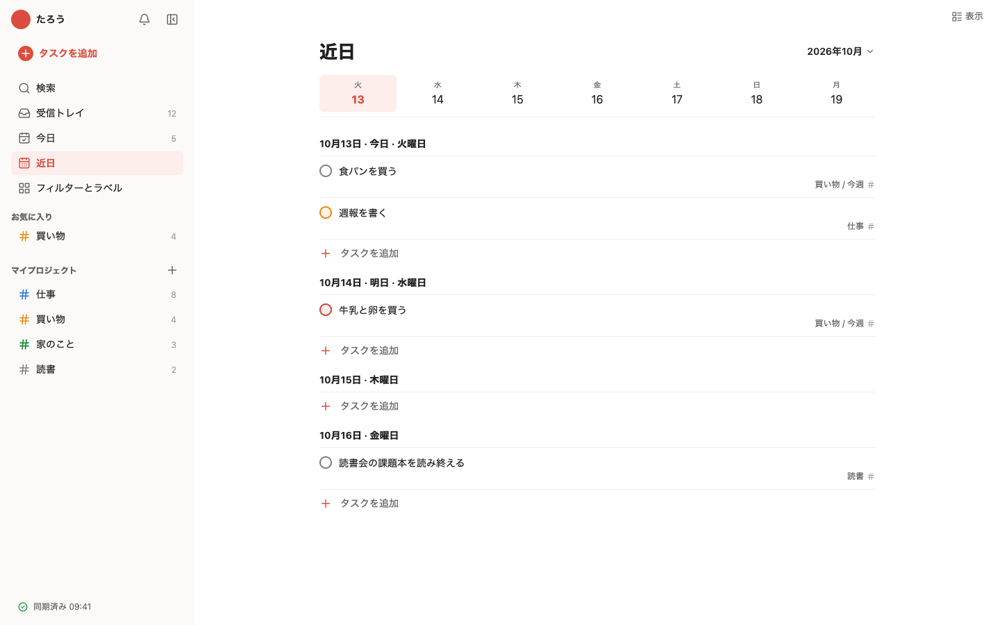 |
| フィルターとラベル | ラベルの一覧、色、名前の変更、削除。ラベルを押すと、そのラベルのタスクが出る | 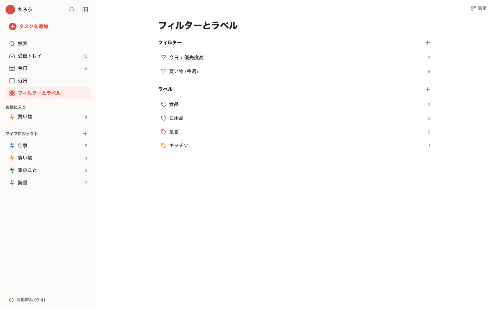 |
| プロジェクト | セクションとタスク。サブタスクは開いて見る | 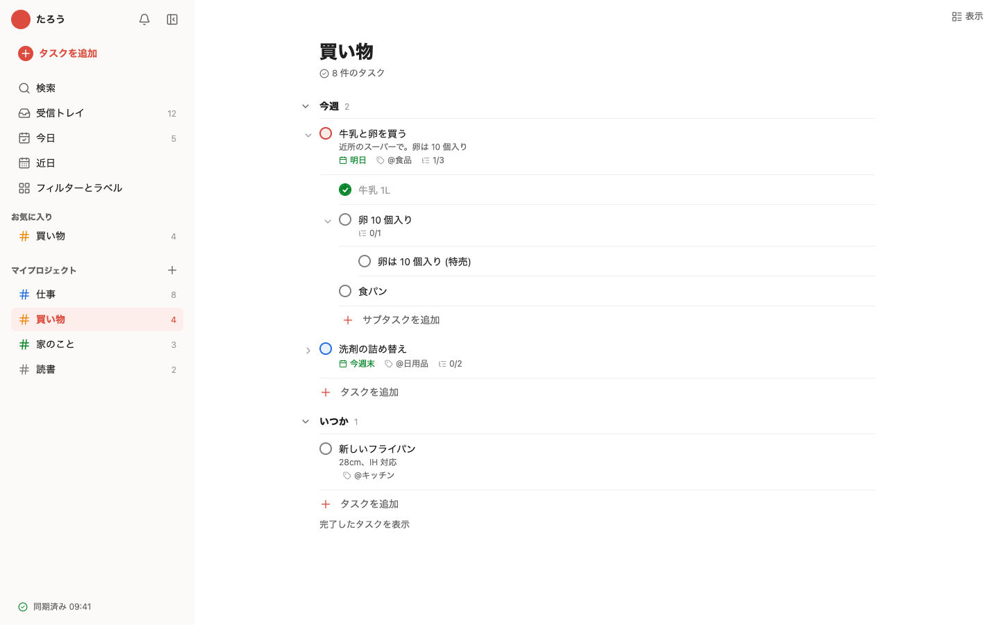 |
| ボード | プロジェクトをセクションの列で見る (「表示」で切り替える) | 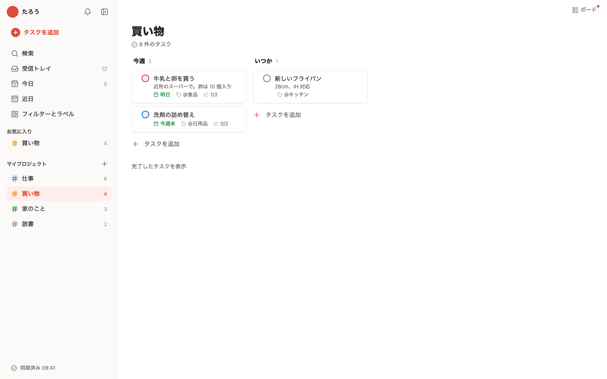 |

- 件数は、その画面に見えている未完了の行の数である。完了した親の下のサブタスクは数えない。
- 今日と近日には、期限のあるサブタスクも 1 行として出る。
- 右上の「表示」で、並び替え (手動、名前、日付、時刻、追加日、優先度。優先度は、同じ優先度の中を時刻順にし、時刻が同じものと無いものは手動の並びにする)、グループ、フィルター、完了したタスクを選べる。選んだ内容は共通ファイルに残り、ほかの端末と同期する。
- 右上の「…」は、プロジェクトと受信トレイにだけ出る (下の「プロジェクトの操作」)。
- 保存するフィルター (「フィルターとラベル」の画面のフィルターの追加) は、まだ作っていない。

## タスクの操作

行にマウスを乗せると、右に操作のボタンが出る (編集、日付、コメント、「…」)。「…」には、上や下への追加、編集、期限、優先度、リマインダー、移動、複製、削除がある。

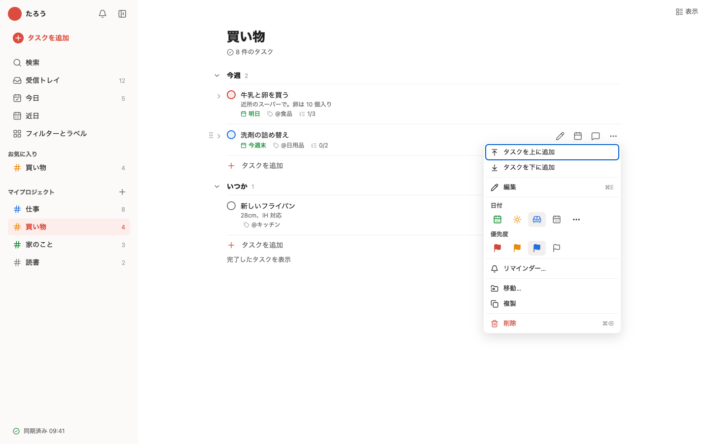

行を押すと、タスクの詳細が画面の中央に開く。

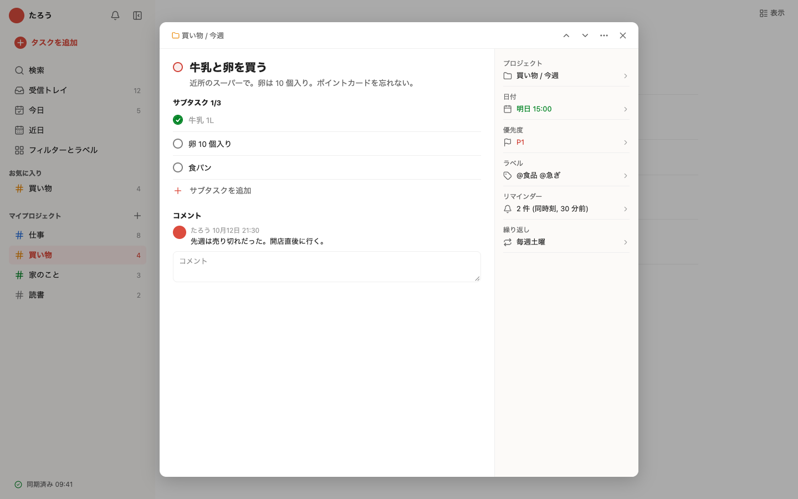

- 右の欄で、プロジェクト、日付、優先度、ラベル、リマインダー、繰り返しを変える。
- サブタスクの行を押すと、そのサブタスクの詳細が開く。上の「プロジェクト / 親のタスク」の親の名前で戻る。
- 完了を押すと、詳細は閉じる。開いていたのがサブタスクなら、親へ戻る。
- 削除すると、次のタスクへ移る。開いていたのがサブタスクなら、親へ戻る。
- プロジェクトを変えても、移した先の同じタスクを開いたままにする。
- `j` と `k`、または上の `∨` `∧` で、前後のタスクへ移る。
- 親を完了すると、未完了のサブタスクも完了になる。「元に戻す」で一緒に戻る。

ドラッグで、行の並べ替え、字下げ (サブタスクにする)、別の日やプロジェクトへの移動ができる。

## クイック追加

`q` か、左上の「タスクを追加」で開く。一覧の「タスクを追加」の欄と、行の編集欄でも、同じ言葉を読み取る。読み取った言葉には色が付く。

| 書くもの | 例 | 意味 |
|---|---|---|
| 日付 | `今日` `明日` `明後日` `今週末` `来週` `来週金曜` `11/20` `today` `tomorrow` `next fri` | 期限 |
| 時刻 | `8:00` `15時` `午後3時` `3pm` | 期限の時刻 |
| 繰り返し | `毎週水曜` `毎月1日` (下の「繰り返し」) | 繰り返し。期限は最初の回になる |
| 優先度 | `p1` から `p4` | p1 が一番高い |
| ラベル | `@食品` | ラベル。複数書ける |
| プロジェクト | `#仕事` | 入れるプロジェクト |

読み取れない言葉はタスク名に残る。

日付のポップアップの「日付を入力」の欄にも、同じ言葉を書ける。`毎週水曜 10:00` と書いて `Enter` を押すと、期限、時刻、繰り返しがまとめて入る。この欄では `金曜` のような曜日だけの言葉も読み取る (次のその曜日になる)。

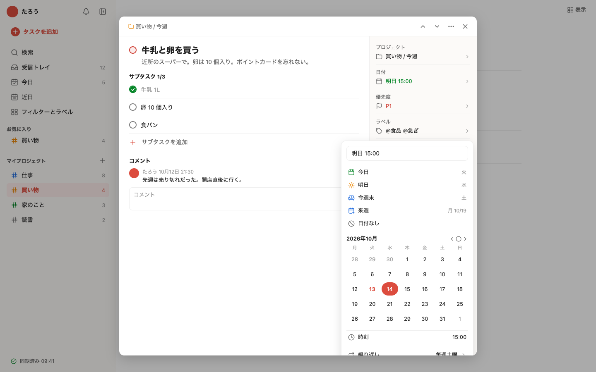

## 繰り返し

日付のポップアップの「繰り返し」、繰り返しの欄、クイック追加に、次のように書く。日本語と英語のどちらでもよい。全角と半角、英語の大文字と小文字は区別しない。

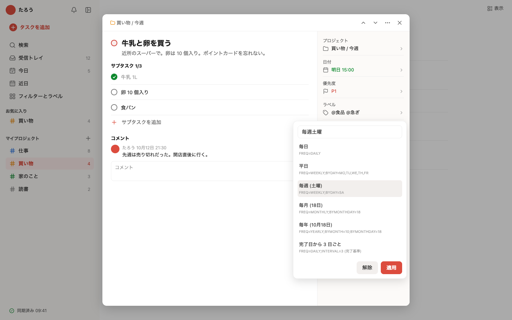

| 入力 | 意味 |
|---|---|
| 毎日 / every day / daily | 毎日 |
| 平日 / every weekday / weekdays | 月曜から金曜 |
| 毎週 / every week / weekly | 毎週 (曜日は期限の曜日) |
| 毎週月曜 / 毎週月 / every monday / every mon | 毎週月曜 |
| 毎週月水金 / every mon,wed,fri | 毎週月・水・金 |
| 隔週 / every 2 weeks / every other week | 2 週間ごと |
| 毎月 / every month / monthly | 毎月 (日は期限の日) |
| 毎月1日 / 毎月 15 日 / every month on the 1st / monthly on 15 | 毎月その日 |
| 毎月末 / 月末 / 毎月月末 / 毎月 月末 / 毎月最終日 / 月末日 / every month end / last day of month | 毎月末 |
| 毎年 / every year / yearly | 毎年 (月日は期限) |
| 毎年10月18日 / every oct 18 | 毎年その月日 |
| 3日ごと / every 3 days | 3 日ごと |
| 毎3日! / 3日ごと! / every 3 days! | 3 日ごと。末尾の `!` で「完了した日から」数える |

- 曜日は 月 火 水 木 金 土 日 / 月曜 / 月曜日 / mon / monday。複数書いたら後ろが勝つ。
- クイック追加で期限の言葉を書かないときは、最初の回 (今日が当たる日なら今日) が期限になる。
- 完了すると、進捗は 0 のまま、期限だけが次の回へ進む。完了の取り消しでは期限を戻さない。
- 完了すると、完了していたサブタスクが未完了に戻る (Todoist と同じ)。「元に戻す」で、期限とサブタスクが戻る。
- 読めない繰り返しのタスクは、ふつうに完了になる。「繰り返しの指定が読めません」と知らせる。
- xlsx の「繰り返し」列の書き方は [内部資料のデータ](internal/data-model.md) にある。

## リマインダーと通知

時刻になると、OS の通知が出る (30 秒ごとに確かめる)。

| コード | 意味 |
|---|---|
| `-0m` | 期限と同じ時刻 |
| `-10m` `-30m` `-60m` | 10 分前、30 分前、1 時間前 |
| `-1d` | 前日の 9:00 |
| `-1w` | 1 週間前の 9:00 |
| `2026-10-20T09:00` | 日時の指定 (ローカル、分まで) |

- 期限に時刻が無いタスクで使えるのは `-1d` と `-1w` だけである。「9:00」は設定の「日付と時刻」の「時刻なしの通知時刻」で変えられる。
- アプリで時刻つきの期限を付けると、リマインダーが空なら「既定リマインダー」を 1 つ付ける (初期値は同じ時刻。なし、10 分前、30 分前、1 時間前、前日にも変えられる)。Excel で作った行には付かない。
- 繰り返しで期限が進んでも、相対のリマインダーは次の回にも効く。日時の指定は過去になるので外れる。
- 通知のボタンは「後で (10 分)」と「完了」。通知を押すと、ウインドウが出てタスクの詳細が開く。
  - macOS では、2 つのボタンが通知の「オプション」にまとまる。「オプション」自体を押すと「後で (10 分)」になる。
  - Windows では、通知が画面に出ている間だけボタンが効く。
  - 古い通知のボタンは、タスクを変えずにウインドウを出すだけである。
  - 「完了」が失敗したとき (未保存の帯があるプロジェクトなど) は、ウインドウを出して理由を出す。
- 通知が出るかどうかは OS の設定で決まる (macOS: システム設定 > 通知 > PowerToDo)。アプリから権限を求めない。設定の「通知」で通知を切っても、画面上の「リマインダー」の帯は出る。
- 「後で」は、そのときの期限に対するものである。後でにしたあと期限が変わると、新しい期限のリマインダーが出る。
- 画面上の帯: 届いたリマインダーが残る。「完了」、「後で」(10 分、1 時間、明日の通知時刻)、「開く」、「閉じる」を選べる。通知を逃しても帯に残る。2 件以上は「N 件のリマインダー」にまとまり、「すべて閉じる」で一度に閉じられる。
- アプリを止めている間に過ぎたリマインダーは、次の起動で 1 通の通知「N 件のリマインダーがありました」と帯にまとまる (1 件だけならふつうの通知)。前回の確認より後で、起動より前の分が対象である (初回は 24 時間前から)。
- 届けた記録は、端末ごとに `fired.json` に残る ([内部資料のデータ](internal/data-model.md))。同期しないので、端末ごとに 1 回ずつ通知が出る。

## コメントと添付

タスクの詳細の下で、コメントを書く。`Enter` で送り、`Shift+Enter` で改行する。自分のコメントは、マウスを乗せると編集と削除ができる。

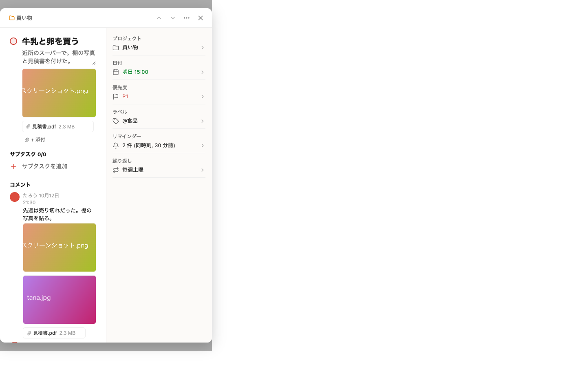

コメントと説明には、画像やファイルを付けられる。

| 付け方 | コメント | 説明 |
|---|---|---|
| ボタン | 入力欄のクリップ | 説明の下の「+ 添付」 |
| 貼り付け | 入力欄に貼る | 説明の欄に貼る |
| ドラッグ&ドロップ | 入力欄に落とす | ダイアログのほかの場所に落とす |

- 画像は縮小表示で並ぶ。押すと大きく表示する。`←` `→` で前後へ、`Esc` で閉じる。
- 画像以外のファイルは、名前と大きさで並ぶ。押すと既定のアプリで開く。右クリックで「Finder で表示」と「別名で保存」。
- 長い辺が 2048 px を超える画像は、2048 px の JPEG にして保存する。2048 px 以下の JPEG、PNG、WebP はそのまま保存する。GIF は動きを残すため、大きさによらずそのまま保存する。HEIC はいつも JPEG にする。
- ファイルは 1 つ 50 MB までである (画像は縮小したあとの大きさ)。
- 説明の添付の × で外す。帯の「元に戻す」で戻る。
- 行の 2 段目に、コメントの数と添付の数 (クリップ) が出る。
- まだ同期で届いていない添付は、灰色の枠に「同期中」と出る。
- 設定の「同期」に、添付の数と合計の大きさが出る。

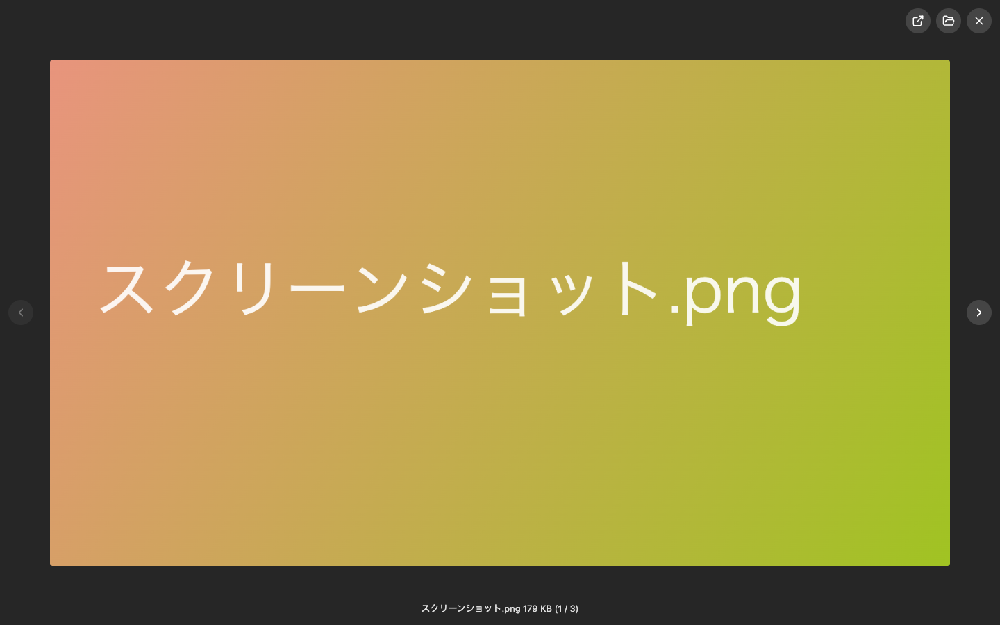

**注意**: v0.5.0 より前の版は、同期で記録を合わせるときに、説明の添付の記録を消す。説明に添付する前に、すべての端末を v0.5.0 以降にする。コメントの添付は、古い版が混ざっても消えない。

## プロジェクトの操作

プロジェクトの右上の「…」から操作する。

| 項目 | 内容 |
|---|---|
| 編集 | 名前と色を変える |
| お気に入りに追加 / お気に入りから外す | 左の一覧の「お気に入り」に出す |
| セクションを追加 (キーは `s`) | セクションを足す |
| データを管理 › Excel で開く | プロジェクトの xlsx を既定のアプリで開く |
| データを管理 › Finder で表示 | xlsx をファイラで見せる (Windows は「エクスプローラーで表示」、Linux は「ファイルマネージャーで表示」) |
| アーカイブ | 左の一覧から外す。ファイルはそのまま残る |
| 削除 | ファイルを `archive/` へ移す (確認あり) |

受信トレイの「…」は、「セクションを追加」と「データを管理」だけである。今日、近日、ラベルの画面に「…」は無い。

アーカイブしたプロジェクトは、件数、今日、近日、ラベル、検索、リマインダー、クイック追加の候補、タスクの移動先から外れる。左の一覧の最後の「アーカイブ済み」から開くと、読むだけの画面になる。上の帯の「アーカイブから戻す」で戻す。アーカイブしたプロジェクトの「…」は、「データを管理」と「削除」だけである。

## 検索

`Cmd/Ctrl+K` か `/` で開く。ひらがなとカタカナ、全角と半角、大文字と小文字の違いを区別しない。複数の語は、すべてを含むものを探す。

## 設定

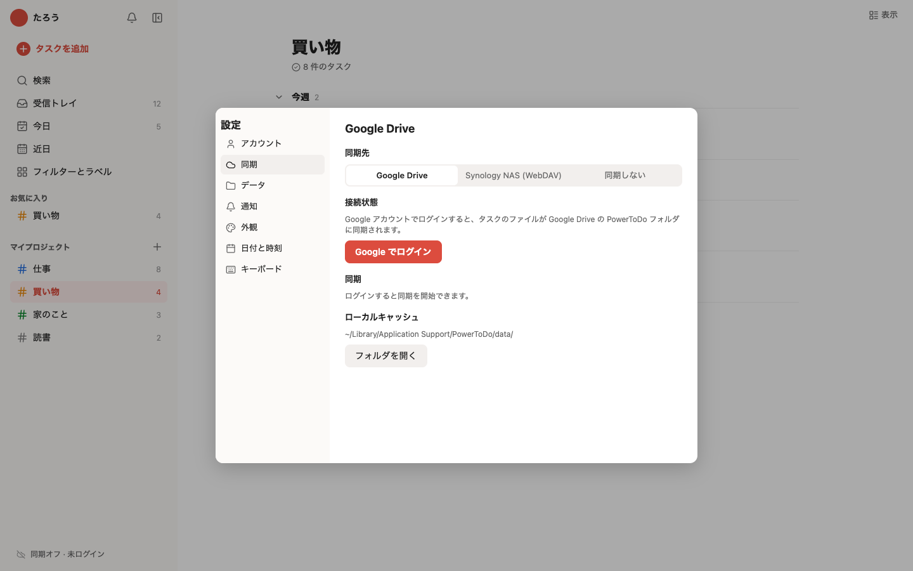

| 欄 | 内容 |
|---|---|
| 全般 | 起動時に開く画面 (今日 / 受信トレイ)。端末ごと |
| アカウント | 表示名 (コメントの書き手) |
| 外観 | まだ中身が無い (ダークの切り替えは後の作業) |
| 日付と時刻 | 週の開始、既定リマインダー、時刻なしの通知時刻 |
| 通知 | 通知、閉じたときトレイに残す、ログイン時に起動 |
| 同期 | 同期先、状態、添付の使用量 ([同期](05-sync.md)) |
| データ | データフォルダの場所 |
| キーボード | キーの一覧 |
| アップデート | 今の版、起動時に更新を確かめる、「更新を確認」 |

ウインドウの大きさ、位置、最大化は、次の起動で戻る。

## キー

入力欄で文字を打っている間と、日本語入力の変換中は効かない。`Shift` を押しながらのキーは何もしない (`↑` `↓` `←` `→` を除く)。ダイアログが開いている間は、ダイアログのキーが先に効く。

| キー | 動作 |
|---|---|
| `q` | クイック追加 |
| `Cmd/Ctrl+K`、`/` | 検索を開く (`/` は入力中以外) |
| `g` のあと 1 秒以内に `t` / `u` / `i` / `l` | 今日 / 近日 / 受信トレイ / フィルターとラベルへ移る |
| `↑` / `↓` | 選んでいる行を上下に動かす (折りたたんだ行は飛ばす) |
| `Enter` | 選んでいる行の詳細を開く (検索では移って開く) |
| `e` | 選んでいる行を完了 / 取り消し |
| `Delete` / `Backspace` | 選んでいる行を削除 (確認あり) |
| `1` から `4` | 優先度を p1 から p4 にする |
| `t` / `m` | 期限を今日 / 明日にする (時刻は保つ) |
| `→` / `←` | サブタスクを開く / 閉じる (プロジェクトの画面) |
| `s` | セクションを追加 (プロジェクトの画面) |
| `Cmd/Ctrl+E` | 選んでいる行を編集する |
| `Cmd/Ctrl+Backspace` | 選んでいる行を削除 (確認あり) |
| `Alt+↑` / `Alt+↓` (macOS は `⌥`) | 選んでいる行を上下に並べ替える (プロジェクトと今日の画面) |
| `Ctrl+]` / `Ctrl+[` | 選んでいる行を字下げする / 戻す (プロジェクトの画面) |
| `j` / `k` | 詳細で次 / 前のタスクへ |
| `Esc` | 一番上のダイアログを閉じる。何も開いていなければ行の選択を外す |

- 行のキーは、行を選んでいるときだけ効く。マウスを乗せても行は選ばれない。
- `Tab` でボタンやリンクを選んでいる間は、そのボタンが `Enter` `Space` `Delete` `Backspace` を使う。

## トレイ

- macOS と Windows: ウインドウを閉じても終わらず、トレイに残って通知を出し続ける。設定の「通知」の「閉じたときトレイに残す」を「いいえ」にすると、閉じたときに終わる。
- トレイのアイコンは、macOS では単色 (メニューバーの明暗に合わせる)、Windows と Linux ではアプリのアイコンである。
- トレイのメニュー: 「PowerToDo を開く」、「タスクを追加…」(ウインドウを出してクイック追加を開く)、「今すぐ同期」(同期先につながっているときだけ)、「終了」。「終了」は、未保存の帯があるとウインドウを出して確かめる。
- macOS では、Dock のアイコンを押してもウインドウが戻る。
- Linux (Ubuntu) では、ウインドウを閉じると終わる (トレイに残らない)。デスクトップによってはトレイが無く、ウインドウに戻れなくなるためである。
- アプリは 1 つだけ動く。もう一度起動すると、動いている方のウインドウが出る。
- ログイン時に起動: PC にログインすると PowerToDo が起動する (ウインドウも開く)。最初からオンで、設定の「通知」で切れる。macOS はログイン項目 (LaunchAgent)、Windows はレジストリの Run キー、Linux は `~/.config/autostart` に登録する。OS の設定で外したときは、アプリはそれに従う (登録し直さない)。macOS の「システム設定 > 一般 > ログイン項目」で「バックグラウンドでの実行を許可」を切った場合と、Linux のデスクトップが項目を消さずに無効にした場合は、アプリからは見えず、スイッチはオンのまま表示される (起動はしない)。macOS ではアプリのスイッチを切り替えても戻らないので、システム設定の側で入れ直す。開発中のビルド (`tauri dev`) は登録しない。

## Excel で直したとき

アプリを開いたまま、Excel や LibreOffice で xlsx を直して保存してよい。アプリはデータフォルダを見張っていて、変わったファイルを次のように扱う。

| 状況 | アプリの動き |
|---|---|
| アプリに未保存の変更が無い | 自動で取り込む。「「<プロジェクト名>」の Excel での変更を取り込みました」と出る |
| アプリに未保存の変更がある | 自動保存を止めて、上に帯を出す。選ぶまで、そのプロジェクトは保存されない |
| ファイルが消えた、動いた | 「ファイルが見つかりません」と出る。新しい xlsx を置くと、プロジェクトとして一覧に加わる |
| 読み込みに失敗した (保存の途中、ロック中など) | 画面は変えず、「読み込めません」の帯を出す。次の保存で読めたら帯は消える |

帯の選び方:
- 「ファイルを読み込む」: Excel の内容を読み込む。アプリの未保存の変更は失われる (確認あり)。
- 「このアプリの内容で上書き」: アプリの内容をファイルに書く。Excel の変更は失われる (確認あり)。

そのほか:
- 共通ファイル (`_PowerToDo.xlsx`) も同じである。帯には「共通設定」と出る。
- Excel 側で形の壊れた行は「要修正」として出る。直してから読み込み直す。
- ロックファイル (`~$` で始まるもの、`.~lock.` で始まるもの) は無視する。
- 帯が出たまま終わろうとすると (ウインドウを閉じる、macOS のメニューの「PowerToDo を終了」や `Cmd+Q`)、確かめる。「上書きして終了」はアプリの内容で上書きして終わる。「終了しない」は戻って帯で選び直す。Excel の内容を採りたいときは、先に帯の「ファイルを読み込む」を押す。
- 確かめられない終わり方 (macOS の Dock の「終了」、ログアウト、システムの終了) では、帯が出ているファイルと、直前に Excel で変わったファイルには書かない。代わりに、アプリの内容を `archive/<プロジェクト名> (未保存 YYYYMMDD-HHMM).xlsx` (共通ファイルは `archive/_PowerToDo (未保存 YYYYMMDD-HHMM).xlsx`) に書き出す。必要な行はそこから写す。
- 帯が出ている間は、データフォルダを変えられない。

## 自動更新

- 起動の 5 秒後に、新しい版があるかを 1 度だけ確かめる。見つかると「新しいバージョンがあります」が出る。「今すぐ更新」で、ダウンロード、入れ替え、再起動まで進む。「あとで」にした版は、次の起動まで出ない。
- クイック追加や検索を開いている間と、文字を打っている間は、ダイアログを出さずに待つ。設定の「更新を確認」で調べたときは、すぐ出る。
- 同期の途中で「今すぐ更新」を押すと、同期が終わるのを待つ (最大 60 秒)。終わらなければ更新をやめる。データは変わらない。
- 設定の「アップデート」に、今の版、「起動時に更新を確認する」(既定はオン)、「更新を確認」がある。起動時の確認を切っても、「更新を確認」で調べられる。
- GitHub の最新の release を見る。pre-release (テスト用) は届かない。
- 更新ファイルは署名つきである。アプリの公開鍵で確かめてから入れる。確かめられなければ入れずに理由を出す。
- 自動で更新できない入れ方:
  - Linux の deb と rpm (AppImage から動かしていないとき): 設定に「この入れ方では自動更新できません」と release ページへの案内が出る。新しい版を手で入れ直す。
  - 開発版 (`npm run tauri dev`、debug ビルド): 「開発版のため更新を確認しません」と出る。

## 次に読むもの

- iPhone で使う: [iPhone](04-iphone.md)
- 端末の間で使う: [同期](05-sync.md)
