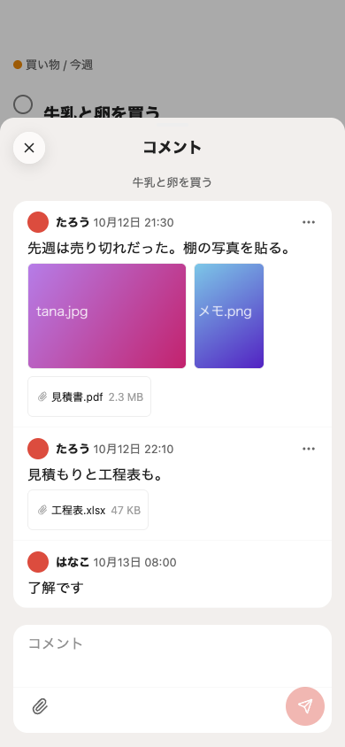
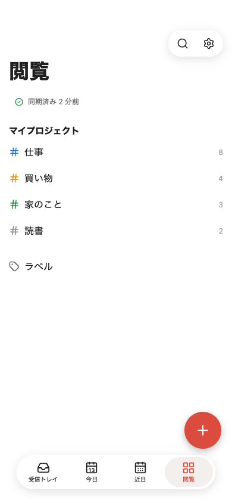

# iPhone

iPhone 版は、デスクトップと同じ中身 (Rust) と画面 (React) を、Tauri の iOS 向けにビルドしたものである。見た目は Todoist の iPhone 版に合わせている。iPad では、iPhone の画面がそのまま大きく出る。入れ方は [iOS のビルド](internal/ios-build.md) にある。

| 今日 | プロジェクト | タスク | コメント | 閲覧 |
|---|---|---|---|---|
|  |  |  |  |  |

## 画面

下のタブは「受信トレイ」「今日」「近日」「閲覧」の 4 つである。

- 受信トレイ、今日、近日、閲覧の上の帯の左のボタン (三本線) で、左のメニューが開く。画面の左端から右へ払っても開く。デスクトップの左の一覧と同じ並び (検索、受信トレイ、今日、近日、フィルターとラベル、お気に入り、マイプロジェクト、設定) である。背景を押すか、左へ払うと閉じる。

- 閲覧: 同期の状態、マイプロジェクト、ラベル。上の検索と設定のボタンもここにある。
- 大きな見出しは、下へスクロールすると上の帯の小さな見出しになる。
- 長いタスク名は、デスクトップと同じように、一覧で折り返して全部出る。
- 右下の追加ボタンで、クイック追加のシートが開く。書き方はデスクトップと同じである ([クイック追加](03-desktop.md#クイック追加))。「今日」の画面では入力欄に「今日」が、「近日」の画面では一覧の上に見えている日付が入った状態で開く。
- クイック追加の下のチップ (日付、優先度、プロジェクト、「+」の中のラベルとリマインダー) を押すと、一覧のシートで選べる。選んだものは入力欄の語になり、同じ種類の語があれば置き換える。
- プロジェクトと受信トレイの上の「…」から、セクションを足す。各セクションの末尾の「タスクを追加」で、そのセクションにタスクを入れる。展開した親の下の「サブタスクを追加」は、その親のサブタスクになる。
- ダークモードは、iPhone の設定に従う。

## 行の操作

| 操作 | 動作 |
|---|---|
| 右へスワイプ | 完了 |
| 左へスワイプ | 日付のシート (時刻も選べる) |
| 長押しして、動かさずに離す | メニュー (日付、優先度、移動、削除) |
| 長押ししたまま動かす | 並び替え (プロジェクト、受信トレイ、今日の「今日」のグループ)。赤い線のところへ移る。プロジェクトでは、右へ動かすと上の行の子になる。近日では、別の日へ動かすとその日に変わる |
| 一覧を上から引っ張る | 同期 |

完了や移動のあとには「元に戻す」つきのお知らせが出る。

インボックス、プロジェクト、今日、近日の右上の「表示」のボタン (一覧の印) で、「表示」のシートが開く (Todoist と同じ形)。行は「項目 + 今の値 + ›」で、押すと選ぶページが開き、選ぶと戻る。「完了したタスク」(プロジェクトとインボックス) はスイッチである。決めた内容は、右上の赤いチェックで保存する (「×」で捨てる)。並び替え (手動、名前、日付、時刻、追加日、優先度)、並び順、グループ、期限と優先度の絞り込みを選べる。デスクトップの「表示」と同じ設定で、同期して同じになる。手動以外やグループありのとき、プロジェクトでは、セクションの代わりにグループが並び、長押しの並び替えは止まる。

日付のシートの「時刻」は、「時刻を追加」で足し、時と分 (5 分刻み) を iPhone の回すピッカーで選ぶ。足したときの時刻は、いまの次の区切り (30 分ごと) から始まる。

行の日付の後には、時刻が「明日 7:30」のように出る (Todoist と同じ)。今日の画面の「今日」のグループは、時刻だけが出る。今日の時刻が過ぎたものは、日付と同じ赤で出る (デスクトップも同じ)。

## タスクの画面とコメント

行を押すと、タスクの詳細が下からポップアップで開く (一覧は後ろに残る。下へ引くか、「×」か、外側を押すと閉じる)。説明、プロジェクト (とセクション)、日付、優先度、ラベル、リマインダー、繰り返し、サブタスク、コメントを扱う。「プロジェクト」の行を押すと、移す先を選べる。サブタスクは親と一緒に動くので、この行は出ない。サブタスクの行を押すと、そのサブタスクの画面が開き、戻るで親の画面に戻る。画面の左端から右へ払っても戻る。

- 「コメント N」に最新のコメントが出る。「すべて表示」か下の入力欄で、コメントのシートが開く。
- 自分のコメントは「…」から編集と削除ができる。
- 入力欄のクリップで、写真ライブラリ、カメラ、ファイルから添付する。初めてカメラを使うときに許可を求める。
- 画像は全画面で見る。ピンチで拡大、左右のスワイプで前後へ、下へのスワイプで閉じる。共有のボタンもある。
- 画像以外のファイルは、iOS のプレビュー (Quick Look) で開く。そこから「ファイル」App へ保存できる。
- 説明の添付は、タスクの画面で足して外す。外したあとは「元に戻す」で戻る。
- 縮小のきまりと大きさの上限は、デスクトップと同じである ([コメントと添付](03-desktop.md#コメントと添付))。

## Google カレンダー

デスクトップと同じように、プロジェクトの「…」→「Google カレンダー」で、アカウントとカレンダーを選ぶ ([デスクトップの説明](03-desktop.md#google-カレンダー))。設定の「Google カレンダー」で、アカウントを追加する (アプリの中のログイン画面が開く)。予定の行を押すと、下から詳細のシートが開く。予定は、プロジェクトの一覧の上 (「予定 8 件」の見出しでたたむ。たたむと今日の分を 3 件まで)、今日と近日の各日の先頭 (3 件まで、「ほか n 件」で開く) に、表示だけで出る。1 つのプロジェクトに、複数のカレンダー、複数のアカウントを選べる。一覧を引っ張ると取り直す。

## データと同期

- データは「ファイル」App の「このiPhone内 → PowerToDo」にある。保存先を選ぶ画面は無い。
- iPhone の Excel で直した内容は、アプリに戻ったときと、同期の前に取り込む。未保存の編集があるプロジェクトは、デスクトップと同じく保留して選ばせる。
- 同期するのは、起動したとき、前面に戻ったとき、保存の 5 秒後、前面にいる間の 5 分ごと、一覧を引っ張ったとき、上の同期のボタンを押したときである。背面では同期しない。
- NAS へは、アプリの中の Tailscale (端末名 `powertodo-ios`) でつなぐ。Tailscale のアプリは要らない。Wi-Fi とモバイル回線が切り替わった直後に失敗した同期は、5 秒後と 15 秒後にやり直す。
- パスワードと Google のトークンは、この iPhone のキーチェーンにだけ置く (iCloud に同期しない)。
- Google のログインは、アプリの中のシートで開く。

## リマインダー

通知が届かないときは、設定の「通知の確認」を見る。iPhone に予約されている通知の件数が出る。「10 秒後にテスト通知」を押し、アプリを閉じて待つと、予約した通知が届くかを確かめられる。

iPhone で時刻を付けたタスク (日付のシート、タスクの画面、クイック追加) には、リマインダー「時刻ちょうど」が自動で付く。すでにリマインダーがあるタスクは、そのままにする。外したいときは、タスクの画面のリマインダーで外す。

近い順に 64 件を、iOS の予約通知に登録する。アプリを閉じていても時刻に届く。通知の許可は、初めてリマインダーを登録するとき (または設定で通知をオンにしたとき) に求める。

## 次に読むもの

- 同期の設定: [同期](05-sync.md)
