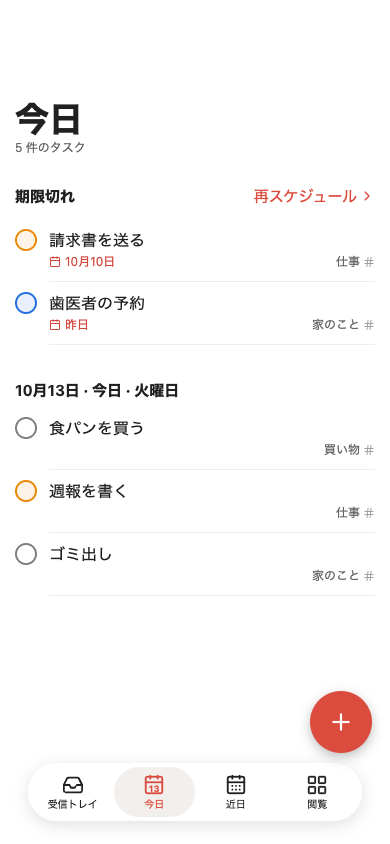
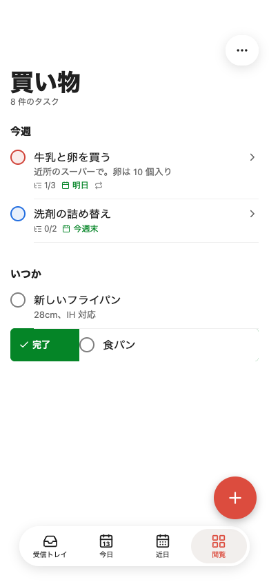
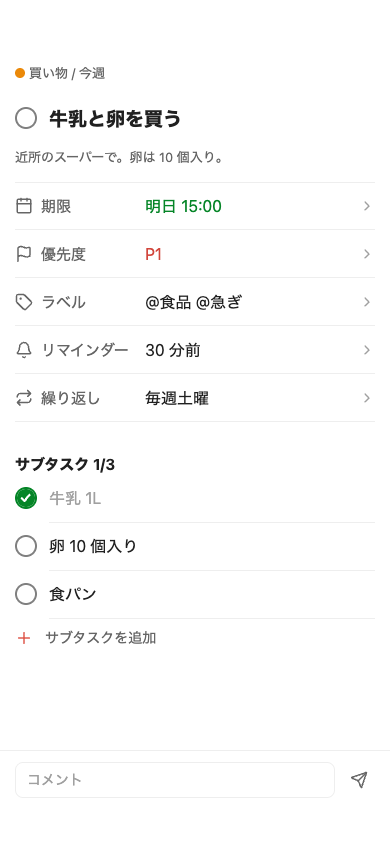

# iPhone

iPhone 版は、デスクトップと同じ中身 (Rust) と画面 (React) を、Tauri の iOS 向けにビルドしたものである。見た目は Todoist の iPhone 版に合わせている。iPad では、iPhone の画面がそのまま大きく出る。入れ方は [iOS のビルド](internal/ios-build.md) にある。

| 今日 | プロジェクト | タスク | コメント | 閲覧 |
|---|---|---|---|---|
|  |  |  |  |  |

## 画面

下のタブは「受信トレイ」「今日」「近日」「閲覧」の 4 つである。

- 受信トレイ、今日、近日、閲覧の上の帯の左のボタン (三本線) で、左のメニューが開く。デスクトップの左の一覧と同じ並び (検索、受信トレイ、今日、近日、フィルターとラベル、お気に入り、マイプロジェクト、設定) である。背景を押すか、左へ払うと閉じる。

- 閲覧: 同期の状態、マイプロジェクト、ラベル。上の検索と設定のボタンもここにある。
- 大きな見出しは、下へスクロールすると上の帯の小さな見出しになる。
- 右下の追加ボタンで、クイック追加のシートが開く。書き方はデスクトップと同じである ([クイック追加](03-desktop.md#クイック追加))。
- クイック追加の下のチップ (日付、優先度、プロジェクト、「+」の中のラベルとリマインダー) を押すと、一覧のシートで選べる。選んだものは入力欄の語になり、同じ種類の語があれば置き換える。
- プロジェクトと受信トレイの上の「…」から、セクションを足す。各セクションの末尾の「タスクを追加」で、そのセクションにタスクを入れる。展開した親の下の「サブタスクを追加」は、その親のサブタスクになる。
- ダークモードは、iPhone の設定に従う。

## 行の操作

| 操作 | 動作 |
|---|---|
| 右へスワイプ | 完了 |
| 左へスワイプ | 日付のシート |
| 長押しして、動かさずに離す | メニュー (日付、優先度、移動、削除) |
| 長押ししたまま動かす | 並び替え (プロジェクトと受信トレイ)。赤い線のところへ移る。右へ動かすと上の行の子になる |
| 一覧を上から引っ張る | 同期 |

完了や移動のあとには「元に戻す」つきのお知らせが出る。

## タスクの画面とコメント

行を押すと、タスクの画面が開く。説明、プロジェクト (とセクション)、日付、優先度、ラベル、リマインダー、繰り返し、サブタスク、コメントを扱う。「プロジェクト」の行を押すと、移す先を選べる。サブタスクは親と一緒に動くので、この行は出ない。

- 「コメント N」に最新のコメントが出る。「すべて表示」か下の入力欄で、コメントのシートが開く。
- 自分のコメントは「…」から編集と削除ができる。
- 入力欄のクリップで、写真ライブラリ、カメラ、ファイルから添付する。初めてカメラを使うときに許可を求める。
- 画像は全画面で見る。ピンチで拡大、左右のスワイプで前後へ、下へのスワイプで閉じる。共有のボタンもある。
- 画像以外のファイルは、iOS のプレビュー (Quick Look) で開く。そこから「ファイル」App へ保存できる。
- 説明の添付は、タスクの画面で足して外す。外したあとは「元に戻す」で戻る。
- 縮小のきまりと大きさの上限は、デスクトップと同じである ([コメントと添付](03-desktop.md#コメントと添付))。

## データと同期

- データは「ファイル」App の「このiPhone内 → PowerToDo」にある。保存先を選ぶ画面は無い。
- iPhone の Excel で直した内容は、アプリに戻ったときと、同期の前に取り込む。未保存の編集があるプロジェクトは、デスクトップと同じく保留して選ばせる。
- 同期するのは、起動したとき、前面に戻ったとき、保存の 5 秒後、前面にいる間の 5 分ごと、一覧を引っ張ったとき、上の同期のボタンを押したときである。背面では同期しない。
- NAS へは、アプリの中の Tailscale (端末名 `powertodo-ios`) でつなぐ。Tailscale のアプリは要らない。Wi-Fi とモバイル回線が切り替わった直後に失敗した同期は、5 秒後と 15 秒後にやり直す。
- パスワードと Google のトークンは、この iPhone のキーチェーンにだけ置く (iCloud に同期しない)。
- Google のログインは、アプリの中のシートで開く。

## リマインダー

近い順に 64 件を、iOS の予約通知に登録する。アプリを閉じていても時刻に届く。通知の許可は、初めてリマインダーを登録するとき (または設定で通知をオンにしたとき) に求める。

## 次に読むもの

- 同期の設定: [同期](05-sync.md)
