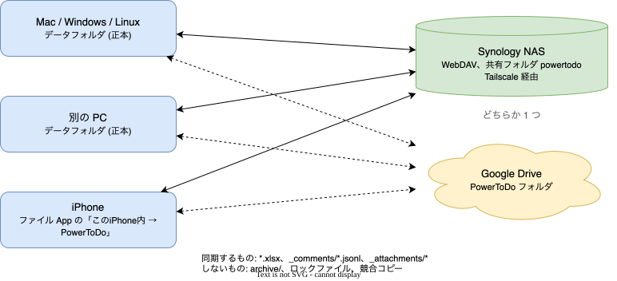
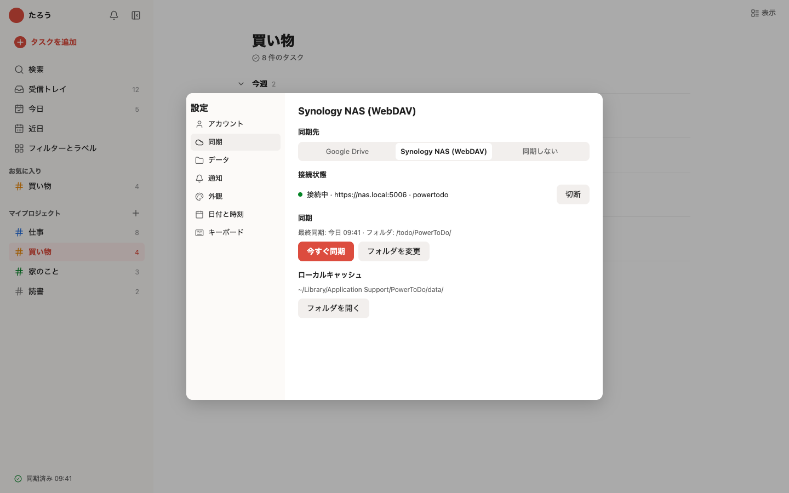
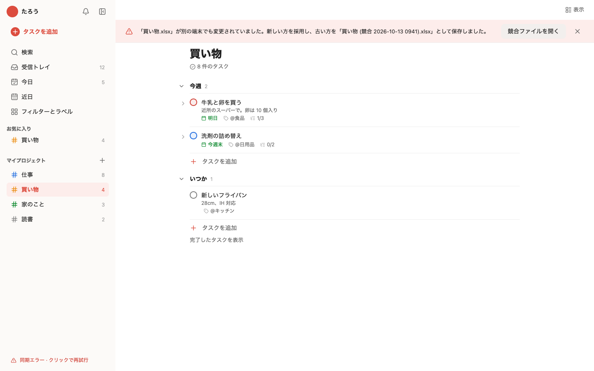

# 同期

データフォルダ (正本) を、Synology NAS か Google Drive のどちらか 1 つに同期する。設定の「同期」で同期先を選ぶ (Google Drive、Synology NAS、同期しない)。初回起動の画面でも選べる。

## 同期するもの

| 同期する | 同期しない |
|---|---|
| データフォルダ直下の `*.xlsx` (プロジェクトと `_PowerToDo.xlsx`) | `archive/` |
| `_comments/*.jsonl` (コメントと添付の記録) | ロックファイル |
| `_attachments/*` (添付のファイル) | 競合コピー |

## いつ同期するか

- 起動したとき、保存の 5 秒後、5 分ごと、「今すぐ同期」を押したとき。
- 30 秒ごとに、同期先のファイルの一覧だけを見る。変わっていれば同期する (手元のファイルは読まない)。
- iPhone や別の PC で変えた内容は、アプリが動いていれば (トレイに隠れていても) 1 分以内に届く。
- 左の一覧の下に、状態 (同期済み、同期中、オフライン、エラー) が出る。
- オフラインの間もデータは失われない。つながったら、次の同期で追いつく。
- 同期先を切り替えると、次の同期で全部のファイルを送り直す。

## Synology NAS (Tailscale 経由)

アプリに入っている Tailscale (サイドカー `powertodo-tailnet`) で NAS につなぐ。各 PC に Tailscale のアプリは要らない。ルーターのポートも開けない。

設定の「NAS の準備手順」にも、同じ 5 つの手順が出る。

1. DSM のパッケージセンターで「WebDAV Server」を入れ、HTTP (ポート 5005) を有効にする。
2. 共有フォルダ `powertodo` を作る。
3. PowerToDo 専用のユーザーを作る。`powertodo` だけを読み書きできるようにし、ほかのフォルダは「アクセスなし」にする。
4. パッケージセンターで「Tailscale」を入れてログインし、NAS の名前を控える。
5. アプリで同期先に「Synology NAS (WebDAV)」を選ぶ。NAS と同じアカウントで Tailscale にログインし、サーバーの URL、ユーザー、パスワードを入れて「確かめる」を押す。例: `http://nas:5005/powertodo/`、ユーザー `たろう`。

Tailscale のログインと承認:
- 「Tailscale にログイン」を押すと、ブラウザでログインのページが開く (開かないときは「ブラウザで開く」)。ログインするまで、アプリが勝手にブラウザを開くことはない。
- この PC は、`powertodo-mac`、`powertodo-win`、`powertodo-linux` という名前の端末として tailnet に加わる。管理画面で端末の承認が有効なときは承認する (それまで「承認待ち」と出る)。
- Tailscale のキーの期限が切れたら、「同期」でもう一度ログインする。
- 30 秒たっても「接続済み」にならないときは、「再試行」と「状態を消してログインし直す」が出る。後者は `<アプリのデータ>/tailscale/` の状態を消して、最初からログインし直す。
- サイドカーが異常終了したときは、5 秒あけて 3 回まで自動で起動し直す。それでも駄目なら「失敗」と理由が出る。

URL は `http://` で書く (`https` は使えない)。NAS の名前は tailnet の端末として確かめ、tailnet に無い名前は断る。ユーザー名は `settings.json` に、パスワードは OS のキーチェーンに保存する。キーチェーンが使えないときは、パスワードをその起動の間だけ覚える。

## Google Drive

Google Drive の `PowerToDo` フォルダに同期する。

- 「Google でログイン」を押すと、ブラウザが開く。許可する。
- 同意の画面で Drive のチェックを外すと、同期できないのでログインを受け付けない。もう一度ログインして、チェックを入れる。
- ログアウトすると、キーチェーンのトークンを消し、Google にも取り消しを送る (オフラインで送れなかったときはそう出る)。
- アプリが見えるのは、このアプリが作ったファイルだけである (`drive.file` のスコープ)。ブラウザで `PowerToDo` フォルダに手で置いた xlsx は同期されない。ほかの端末に渡したいファイルは、データフォルダに置いて同期させる。
- 既存のフォルダを選ぶ画面は無い。アプリが `PowerToDo` フォルダを作り、同じアカウントのほかの端末も同じフォルダを使う。
- 配布版には Google の OAuth クライアントが入っている。自分でビルドしたときの準備は [内部資料のリリース](internal/release.md#google-drive-の-oauth-クライアント) にある。

NAS は WebDAV で直接見えるので、共有フォルダ `powertodo` の直下に置いた `*.xlsx` も同期される。

## 2 台で直したとき

2 台 (や iPhone) で同じプロジェクトを直してから同期すると、前回の同期の中身と比べて、タスクごとに合わせる。

| 状況 | 結果 |
|---|---|
| 別々のタスクを足した、直した | 両方とも残る |
| 同じタスクの同じ項目を両方で変えた | ファイルが新しい方の値になる |
| 片方で消したタスクを、もう片方で直していた | 直した方が残る |
| 両方で同じ番号のタスクを足した | この端末で足した方に新しい番号を振る |
| コメント | 両方の行を合わせる。どちらの行も消えない |
| 添付のファイル | 片側にだけあるファイルを、もう片側へ写す |

前回の同期の中身は、端末ごとにアプリのデータの場所 (`sync-base/`) に置く。

合わせられないとき (アプリを更新して最初の同期、ファイルが読めない、「要修正」の行がある) は、新しい方が残る。負けた方の内容は `<名前> (競合 yyyy-mm-dd hhmm).xlsx` (例: `仕事 (競合 2026-10-16 0930).xlsx`) として、データフォルダと同期先の両方に残る。アプリに帯が出る (「競合ファイルを開く」でデータフォルダを開く)。

- 競合コピーは同期しない。必要な行を元のファイルへ写したら、要らないコピーは各側 (この PC と NAS / Drive) で消す。
- 新しい PC を初めてつなぐときは、同期先のファイルを採る。この PC の同じ名前のファイルと中身が違えば、競合コピーを残す。初めの状態の `受信トレイ.xlsx` と `_PowerToDo.xlsx` は、競合コピーを作らずに同期先の内容へ置き換える。

## 削除と archive

片方でプロジェクトを消すと、もう片方のファイルは `archive/` に移る。物理的には消さない。

- `受信トレイ.xlsx` と `_PowerToDo.xlsx` は、消しても戻る。
- archive の名前は `<名前> (<更新日時>).xlsx`。同じ名前があれば `-2`、`-3` を付ける。
- 場所: この PC は `<データフォルダ>/archive/`、NAS は共有フォルダ `powertodo` の `archive/`、Google Drive は `PowerToDo` フォルダの `archive` フォルダ。
- 添付のファイルは、消したことを伝えない。片側で消しても、もう片側から戻る。

## 片方が空に見えるとき

データフォルダか同期先が空に見える (記録があるのにファイルが 1 つも無い) と、全部を消さないように同期を止める。「同期が止まっています」と出るので、どちらかを選ぶ (確認あり)。

- 「<同期先> の内容でこの PC を戻す」: この PC に同期先の内容を写す。
- 「この PC の内容で <同期先> を戻す」: 同期先にこの PC の内容を写す。

戻す前のファイルは、それぞれの `archive/` に残る。選ぶまで同期は動かない。

## 端末ごとの記録

次のものは同期しない。端末ごとに、アプリのデータの場所 (macOS は `~/Library/Application Support/app.powertodo/`) に置く。

| ファイル | 中身 |
|---|---|
| `settings.json` | データフォルダの場所、同期先、起動時の画面など |
| `sync.json` | 同期の記録 |
| `sync-base/` | 前回の同期の中身 |
| `fired.json` | 届けたリマインダーの記録 |
| `tailscale/` | Tailscale の状態 |

くわしくは [内部資料のデータ](internal/data-model.md) にある。
