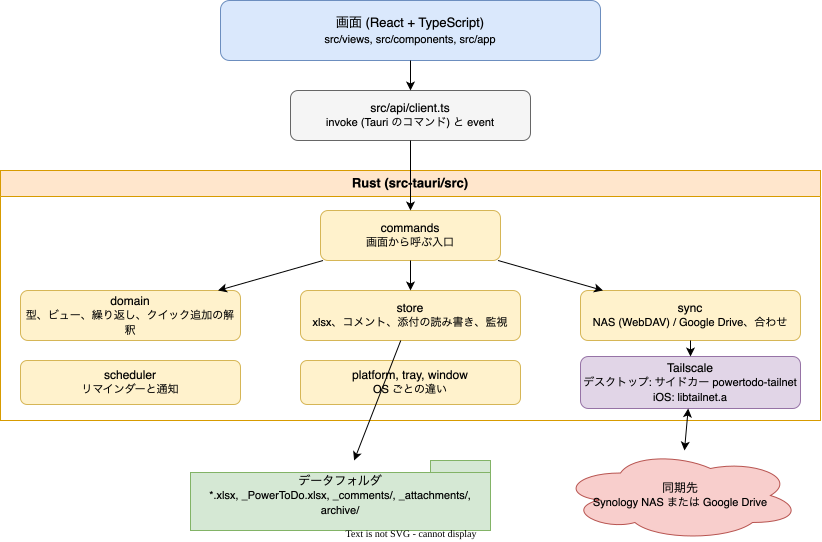
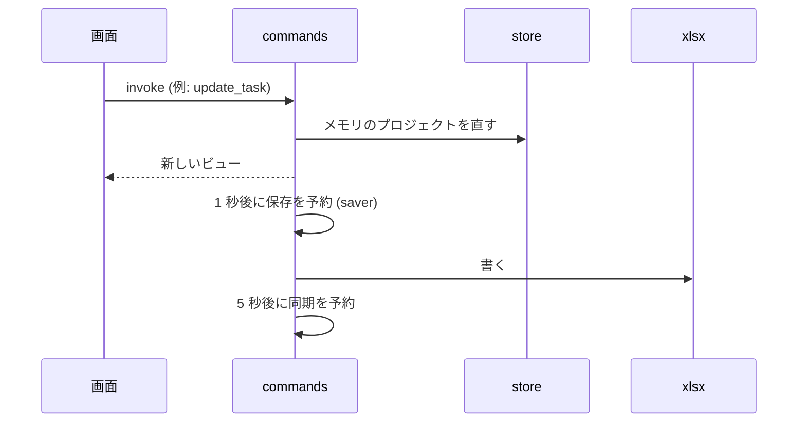
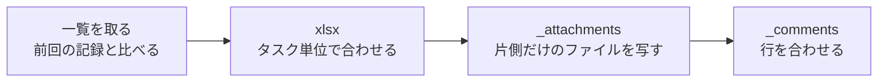

# 構成

画面 (React) は、Rust のコマンドを `invoke` で呼ぶ。Rust はデータフォルダの xlsx を読み書きし、変わったことを event で画面に知らせる。デスクトップと iOS は、同じ Rust と同じ画面のコードを使う。

## Rust (`src-tauri/src/`)

| モジュール | すること |
|---|---|
| `domain/` | 型 (`model.rs`)、横断のビュー (今日、近日、ラベル)、繰り返し、リマインダー、クイック追加と日付の言葉の解釈、検索。入出力も時計も持たない |
| `store/` | xlsx の読み書き (`project_book.rs`、`common_book.rs`)、メモリの中のプロジェクト (`project_store.rs`)、コメント、添付、ラベル、「表示」の設定、データフォルダの見張り (`watcher.rs`)、外部の変更の扱い (`external.rs`) |
| `commands/` | 画面から呼ぶコマンド。保存の予約 (`saver.rs`、変更の 1 秒後に書く)、同期、添付、コメント、更新、ログイン時の起動 |
| `sync/` | 同期のエンジン (`engine.rs`)、タスク単位の合わせ (`merge.rs`)、前回の中身 (`base.rs`)、同期先 (`webdav.rs`、`gdrive.rs`)、Google の OAuth、Tailscale (`tailnet.rs` はデスクトップのサイドカー、`tailnet_inproc.rs` は iOS) |
| `calendar/` | Google カレンダーの取り込み (読むだけ)。Google の JSON を型にする (`parse.rs`)、端末のファイル (`file.rs`)、API の呼び出し (`http.rs`)。予定は xlsx に入れず、`calendar.json` に控える |
| `scheduler/` | 30 秒ごとにリマインダーを確かめ、通知を出す。iOS は予約通知に登録する |
| `platform/` | OS ごとの違い (ファイルを開く、ファイラで見せる、iOS のプレビュー) |
| `tray.rs`、`window.rs` | トレイとウインドウ |

## 画面 (`src/`)

| フォルダ | 中身 |
|---|---|
| `api/` | コマンドと event の型つきの入口 (`client.ts`) |
| `app/` | 画面全体の状態とつなぎ (`Main.tsx` はデスクトップ、`MobileMain.tsx` は iPhone)。フック、キー、ドラッグ、「表示」の並べ方、添付の縮小 |
| `views/` | 画面 (プロジェクト、今日、近日、タスクの詳細、設定など)。`views/mobile/` は iPhone の画面 |
| `components/` | 部品 (行、チェックボックス、チップなど)。iPhone 用の分岐を持つ |
| `styles/` | デザイントークン (`tokens.css`) |
| `stories/` | Storybook の画面一覧 |
| `mock/` | Storybook とテストのためのデータ |

画面の純粋な処理 (並べ方、日付、ジェスチャーの判定など) は `.ts` に分け、`node --test` でテストする。

## 保存の流れ

## 外部の変更

`watcher.rs` がデータフォルダを見張る。Excel などで xlsx が変わると、未保存の変更が無ければ読み直し、あれば保存を止めて帯を出す ([デスクトップ](../03-desktop.md#excel-で直したとき))。

## 同期

- xlsx は、前回の同期の中身 (`sync-base/`) を土台に、タスクごとに合わせる (`merge.rs`)。合わせられないときは競合コピーを残す。
- 添付は名前が中身のハッシュなので、片側にだけあるファイルを写すだけである。記録より先に写す。
- コメントの記録は、両側の行を `id` で合わせる。
- 30 秒ごとの確認は、同期先の一覧の指紋だけを比べる。

## よくある変更

| したいこと | 直す場所 |
|---|---|
| タスクの列を足す | `domain/model.rs` の `Task`、`store/project_book.rs` の `HEADERS` と読み書き、`src/types/model.ts` |
| コマンドを足す | `commands/`、`lib.rs` の `invoke_handler`、`src/api/client.ts` |
| 画面を足す | デザイン (`design/opendesign/`)、`design/storyboard.md`、`src/views/`、Storybook のストーリー |
| 同期先の振る舞い | `sync/backend.rs` の `StorageBackend` と各実装 |
