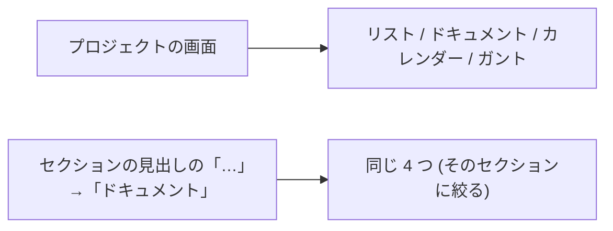

# プロジェクトのドキュメント、カレンダー、ガント (2026-11-28 設計)

プロジェクトとセクションに、管理用のドキュメント (目的、経緯、ソースコードのリンク、要望、やりたいこと) と参考資料のファイルを持たせる。同じ画面で、そのプロジェクトやセクションのタスクと Google カレンダーの予定を、月のカレンダーとガントチャートで見る。

## 決まっていること (所有者の要望と、2026-11-28 の合意)

- ドキュメントは、プロジェクトにも、セクションにも作れる。**1 つのプロジェクトやセクションに、何枚でも作れる**。
- 書き方は**見たまま編集** (整形された画面でそのまま書く)。
- 参考資料のファイルを、ドキュメントに登録できる。
- デスクトップでも iPhone でも、読み書きできる。
- 閲覧の画面で、そのプロジェクトやセクションのタスクとカレンダーの予定を一覧にし、月のカレンダーとガントチャートで出す。
- ガントの棒は、タスクの開始日から期限まで。**開始日が無ければ、期限の日に 1 日分の棒**。期限も無いタスクは、棒を出さず「日付なし」の一覧に入れる。
- 保存は Markdown のファイル (下の「データ」)。本文の中は合わせず、競合したら両方を残す。

## 分け方と作る順

| | 中身 | 仕様 |
|---|---|---|
| 1 | ドキュメントと参考資料 (書く、見る、ファイル、同期) | この文書で細かく決める |
| 2 | 「カレンダー」タブ (月のカレンダー) | この文書は形だけ。作る前に詰める |
| 3 | 「ガント」タブと、開始日の編集 | この文書は形だけ。作る前に詰める |

1 から順に、計画と実装を回す。

## 画面の入口



- デスクトップ: プロジェクトの画面の上の帯に、「リスト」「ドキュメント」「カレンダー」「ガント」の切り替えを足す。
- iPhone: プロジェクトの画面の上の「…」に「ドキュメント」の行を足す。開くと、上に同じ 4 つの切り替えが並ぶ画面になる。
- セクション: 見出しの「…」に「ドキュメント」を足す。開くと、そのセクションに絞った同じ画面になる。
- 「リスト」は今のプロジェクトの画面である。セクションから開いたときは、そのセクションのタスクだけを出す。

## 1. ドキュメントと参考資料

### 一覧

- デスクトップは左、iPhone は上に、ドキュメントの一覧を出す。並びは更新日時の新しい順。「+」で新しいドキュメントを作る。
- 行: 題名、セクション名 (あれば)、更新日時。
- プロジェクトから開いたときは、プロジェクト全体のものと、すべてのセクションのものを並べる。セクションから開いたときは、そのセクションのものだけ。
- 行を押すと、デスクトップは右、iPhone は全画面で開く。

### ドキュメントの中

- 一番上に題名、その下に本文、本文の下に「参考資料」の欄。
- 本文は見たまま編集する。使えるもの: 見出し (3 段)、太字、斜体、取り消し線、箇条書き、番号つき、チェックボックス、引用、コード (行内とブロック)、リンク、表、画像、区切り線。
- 保存は自動。打つのをやめて 1 秒たつか、画面を離れたときに書く。
- 新しいドキュメントは空で始まる。空のときだけ、「雛形から始める」のボタンを出す。雛形は、見出し「目的」「経緯」「リンク」「要望」「やりたいこと」。
- ドキュメントの「…」: 題名を変える、セクションを変える (「プロジェクト全体」を含む)、削除。
- リンクは押すと外のブラウザで開く (編集中はデスクトップで Cmd / Ctrl を押しながら)。

### 参考資料

- 「ファイルを追加」で選ぶ。デスクトップは、ドキュメントの上へのドラッグでも足せる。
- 行: 種類の印、元の名前、大きさ。押すと開く (コメントの添付と同じ開き方)。「…」で外す。
- 画像は、本文の中に入れることもできる (貼り付け、ドラッグ、ツールバーの画像のボタン)。本文の画像は、参考資料の欄には出さない。
- 大きさの上限は、コメントの添付と同じ。

### エディタの部品

- Markdown を読み書きできる、見たまま編集のエディタの部品を使う。どれを使うかは、計画を書くときに、版と、Markdown との行き来で上の要素が欠けないことを確かめて決める。
- iPhone の WebView で、日本語の入力 (変換中の文字) が崩れないことを、決める条件に入れる。

## データ

### ファイル

```text
<データフォルダ>/
  _docs/<プロジェクト名>.<id>.md      ドキュメント 1 枚につき 1 つ
  _attachments/<sha256>.<拡張子>      参考資料と本文の画像 (コメントの添付と共通)
```

- `id` は、作った時刻のミリ秒 (13 桁) と、16 進 16 桁の乱数を `-` でつないだもの (コメントの記録の `id` と同じ形)。題名を変えても、ファイル名は変わらない。
- フォルダは 1 段。同期がサブフォルダを扱わないため。

### 中身

```markdown
---
title: 在庫アプリの管理
section: 在庫アプリ
created: 2026-11-28T10:00:00+09:00
updated: 2026-11-28T10:20:00+09:00
author: たろう
files:
  - {hash: 3f2a…9c, ext: pdf, name: 見積もり.pdf, type: application/pdf, size: 52011}
---

## 目的

...


```

- 先頭 (front matter, YAML) の項目: `title`、`section` (空か無しはプロジェクト全体)、`created`、`updated`、`author` (最後に書いた人の表示名)、`files` (参考資料。項目はコメントの記録の `files` と同じ)。
- 知らない項目は、書き戻しで残す。
- 本文の画像は、データフォルダの `_attachments/` を相対のパスで指す。ほかのエディタで `_docs/` から開いても画像が出る。
- 先頭が読めないファイル: 題名をファイル名から作り、全体を本文として出す。書き戻すときに先頭を付ける。

### 同期

- `_docs/` の処理を足す (一覧、上げる、下ろす、`archive/` へ移す)。NAS と Google Drive の両方。今の `_comments/` と同じ作り。
- 片側だけ変わったファイルは、そのまま写す。
- 両側で変わったとき: 本文は合わせない。`updated` の新しい方をそのまま残す。もう片方は、新しい `id` を付けて、題名を「<題名> (競合 yyyy-mm-dd hhmm)」にした別のドキュメントとして残す。どちらも消えない。
- 参考資料と画像のファイルは、今の `_attachments/` の同期が運ぶ。
- 古い版のアプリは `_docs/` を知らないので、同期せず、触らずに残す。古い版の端末では見えないだけで、壊れない。

### 名前の変更と削除

| 操作 | ドキュメント |
|---|---|
| プロジェクトの名前を変える | `_docs/` のそのプロジェクトのファイルの名前を変える |
| セクションの名前を変える | そのセクションのドキュメントの `section` を書き換える |
| セクションを消す | そのセクションのドキュメントを、プロジェクト全体のものにする (消さない) |
| プロジェクトを消す | そのプロジェクトのドキュメントを `archive/` へ移す |
| ドキュメントを消す | `archive/` へ移す |

### 外で直したファイル

- データフォルダの見張りに `_docs/` を足す。ほかのエディタで直した `.md` を読み直す。
- 開いて編集している最中に外で変わったとき: 画面の内容を保存せずに、外の内容を「<題名> (競合 …)」として足し、知らせる (上の同期の競合と同じ扱い)。

## 2. 「カレンダー」タブ (形だけ)

- 月ごとの升目。タスクは期限の日に出す。開始日のあるタスクは、開始から期限までの帯で出す。
- プロジェクトに結んだ Google カレンダーの予定も、カレンダーの色で同じ升目に出す。セクションから開いたときは、タスクはそのセクションのものだけ、予定はプロジェクトのものすべて (出さない切り替えも付ける)。
- 日を押すと、その日のタスクと予定の一覧。タスクを押すと、今のタスクの詳細。
- iPhone: 上に月の升目 (点で印)、下に選んだ日の一覧。

## 3. 「ガント」タブ (形だけ)

- 左に行の名前、右に日付の目盛りと棒。
- 行: セクションごとにまとめ、その下にタスク。サブタスクは親の下に字下げする。セクションの行には、中のタスクの最も早い日から最も遅い日までの、まとめの棒。
- 棒: 開始日 (H 列「開始」) から期限 (I 列「終了」) まで。開始日が無ければ、期限の日に 1 日分。期限も無ければ、下の「日付なし」の一覧へ。
- 棒の色: 進捗 (G 列) の割合を濃く塗る。完了したタスクは薄く出す (隠す切り替えも付ける)。
- 今日の位置に縦の線。目盛りは日、週、月の切り替え。
- Google カレンダーの予定は、一番上に別の行で出す。
- 編集: デスクトップは、棒の左右のドラッグで日付を動かし、端のドラッグで開始日か期限を変える。iPhone は、棒を押してタスクの詳細で直す。
- 開始日の編集: タスクの詳細 (デスクトップと iPhone) に「開始日」の行を足す。開始日は今の xlsx の H 列で、列は増えない。

## 古い版の端末

- `_docs/`: 古い版は同期も表示もしない。触らずに残す。
- 開始日: 今の版も H 列を読み書きしているので、古い版で直しても残る。

## テスト

- 先頭の読み書き (知らない項目を残す、読めない先頭、`section` の空)、ファイル名の `id`、名前の変更と削除の付け替えは、Rust のテスト。
- 同期の競合 (両側の変更で 2 枚になる、片側だけの変更は写す) は、今の同期のテストの形で。
- Markdown との行き来で要素が欠けないこと (上の「使えるもの」すべて) は、画面の純粋な処理として `node --test`。
- 画面はストーリーを足す (`npm run check:stories`)。iPhone の日本語入力は、実機で確かめる。

## 範囲外

- 2 台での同時編集 (本文の自動の合わせ)。
- ドキュメントの版の履歴 (消したものと競合の負けた側は `archive/` と競合のドキュメントに残る)。
- ドキュメントの検索 (後で決める)。
- 文字の色、セルの結合など、Markdown に無い書式。
